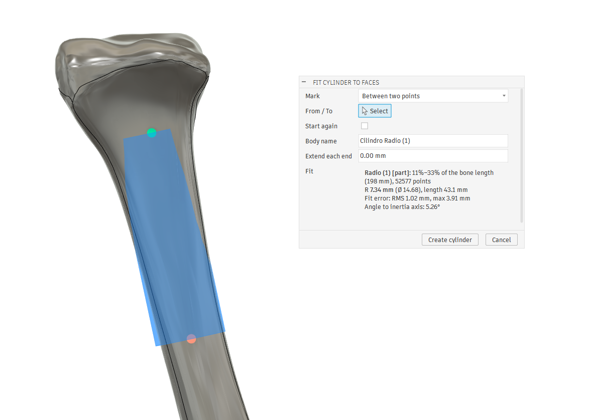

# Fit Cylinder to Faces (FaceRegion)

A Fusion 360 add-in that fits the best cylinder to a marked stretch of a bone and creates it as a
body. The cylinder's axis is the bone's **anatomical axis**: Fusion's own
**Construct → Axis Through Cylinder** then turns it into a construction axis you can measure
from.

## Why

Measurements such as radial inclination, volar tilt or the angle between radius and ulna
need each bone's anatomical axis. In 3-matic that axis comes from a cylinder fitted to the
marked diaphysis. Fusion has no equivalent:
- It can't select a region of a surface triangle by triangle.
- Its tools have no least-squares cylinder fit.

This add-in adds both, for any bone body: an organic NURBS body, a faceted solid or a mesh.

## Using it

**Solid → Create → Fit Cylinder to Faces**

1. Open **Fit Cylinder to Faces** and choose how to mark the stretch:
   - **Between two points** (default, works on any body, including organic NURBS bones,
     allows you to select two different points from a solid's same face):
     click where the diaphysis starts, then where it ends. A green and a red sphere mark
     the two points. The stretch is the whole surface between the planes through those
     points, perpendicular to the bone axis. A third click starts again.
   - **Selected faces** (faceted bodies, one face per triangle): select the faces with
     Fusion's Paint or Window selection, like 3-matic's Brush / Area Mark.
2. The dialog previews the cylinder and reports:
   - The radius and the fit residuals (RMS / max)
   - The angle to the bone's inertia axis
   - In two-point mode, the stretch **as a percentage of the bone length**, so you can
     record and repeat the same marking.
3. Optionally extend each end, name the cylinder, and press OK.

The cylinder is created:
- In a component called `Construcción` (kept apart from the bones);
- In semi-transparent blue, so you can see whether it sits centred in the cortex along the
  whole stretch.

Then use **Construct → Axis Through Cylinder** on it.

<p align="center">
  <br>
  <em>Figure 1. Marking the diaphysis between two points and the fitted cylinder.</em>
</p>

## Measured accuracy

- **Synthetic cylinders with a known answer** (`tests/test_fit.py`): full, noisy, one side only
  (half arc), short-and-wide, and a 90° strip. All are recovered to < 0.03° and < 0.01 mm.
- **Best cylinder:** an independent refit with scipy from 20 random starts
  (`tools/check_scipy.py`) lands on the same axis and radius, with the same cost. Every small
  tilt, shift or radius change around the solution raises the cost.
- **Against 3-matic,** on the same stretch of a radius and an ulna: the axes agree to
  0.45–1.05°, and the radius differs by +0.2–0.3 mm. That's the same order as the effect of
  the marking itself: moving the ends by ±5 % of the bone length changes the axis by up to
  ~0.9°.

The marking is the largest source of variation. Fix a criterion (e.g. 30–70 % of the bone
length) and record the percentages the dialog reports.

## Install

1. Clone or copy this folder anywhere.
2. Run `powershell -File install.ps1`. It copies the add-in to
   `%APPDATA%\Autodesk\Autodesk Fusion 360\API\AddIns\FaceRegion`.
3. In Fusion: **Utilities → ADD-INS → Scripts and Add-Ins → Add-Ins**, select
   **FaceRegion**, tick *Run on Startup* if you want it every session, and press **Run**.
4. The button appears in **Solid → Create**.

No extra Python packages are needed: the fitting is pure Python, because Fusion's
interpreter has no numpy. scipy is only used by the optional `tools/check_scipy.py`.

## How it works

- **Points.**
  - In two-point mode, the whole body is tessellated with triangle sides capped at 1 mm.
    The cap keeps points evenly spread along straight stretches: otherwise a true cylinder
    face tessellates to its two end circles only.
  - The points in the slab between the two clicks are kept. The slab is first cut
    perpendicular to the bone's inertia axis, then re-cut perpendicular to the fitted
    axis until the axis moves less than 0.01° (3–5 rounds).
  - In face mode, the points are the selected faces' vertices.
  - At most 3000 points are used, subsampled.
- **Fit** (`fr_fit.py`): least squares on the distances to the axis minus the radius,
  minimised with Levenberg–Marquardt over the axis point, the axis direction and the radius.
  - It starts from each of the three inertia axes of the points, and the best wins. A patch
    marked on one side of a bone does not have the bone axis as its largest inertia axis.
- **Flat-patch guard:** a nearly flat strip can be fitted better by a huge cylinder lying
  across it than by the bone axis. Candidates with a radius larger than the covered length
  are rejected. If all three starts give one, the dialog refuses to create the body.
- **Checks** (`fr_validate.py`):
  - Local optimality (small perturbations must raise the cost);
  - The centre of each cross-section along the stretch and its offset from the axis;
  - An independent centre line through those centres.

  An axis that "escapes" towards one end shows that the marking included metaphysis.

## Repository layout

| Path | |
|---|---|
| `FaceRegion.py` | add-in shell: lifecycle, toolbar button, events |
| `fr_core.py` | dialog and Fusion work, re-imported on every command |
| `fr_fit.py` | cylinder fit, pure Python, no Fusion imports |
| `fr_validate.py` | optimality and centring checks, pure Python |
| `install.ps1` | copies the add-in into Fusion's AddIns folder |
| `resources/` | toolbar icons |
| `tests/` | offline tests, no Fusion needed |
| `tools/check_scipy.py` | independent refit with scipy |
| `tools/make_icons.py` | draws the icons |

## Tests

```
python tests/test_fit.py
python tests/test_validate.py
```

Both run without Fusion and need only the standard library.

## Known limits

- The result depends on where the stretch starts and ends. See *Measured accuracy*.
- **Selected faces** needs a faceted body. Fusion can't select individual triangles of a
  mesh body, so use **Between two points** on meshes and NURBS bodies.
- The cylinder is a body created through a base feature: it doesn't update if the bone
  changes. Fit it again.
- Lengths are reported in mm. Fusion works internally in cm.

## Licence

MIT. See `LICENSE`.
